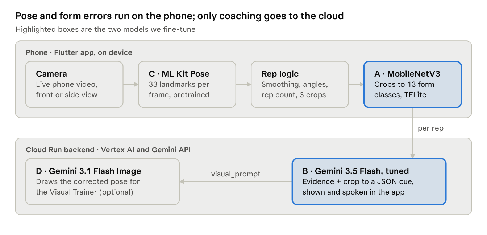

# FormCoach: models and data

CS 663 Computer Vision, Project 2, Group 1: Marianna Belmares, Brent Paterson, Nico Savaides.

FormCoach uses four models: ML Kit Pose (C) finds the body, a fine-tuned MobileNetV3 (A) names the form error, a fine-tuned Gemini 3.5 Flash (B) writes the coaching cue, and Gemini 3.1 Flash Image (D) draws the corrected pose. Every test number comes from group-recorded participants the models never saw in training.

Each frame goes through C on the phone. A finished rep goes through A, and only then does the app call the backend for B's cue. D runs only when the user opens the Visual Trainer.

## Pages

| Page | What's in it |
| --- | --- |
| [[Models]] | Which model fills each course slot, its input and output, where it runs, its baseline |
| [[Data Sources]] | Own recordings and the public datasets, with licenses |
| [[Model A Data Card]] | Train/val/test, collection, counts, format, labels, preprocessing, split, limitations, biases |
| [[Model B Data Card]] | How the Gemini tuning examples are built, reviewed, split and costed |
| [[Models C and D]] | How the two untrained models are evaluated |
| [[Test Set Separation]] | Rules and checks that keep test data out of training |
| [[Workflow]] | Steps from recording to final numbers, with dates to Dec 7 |
| [[Data Collection Protocol]] | How to record participants |
| [[Gemini Labeling Guide]] | How to write Model B's target replies |
| [[Sources]] | Datasets and docs cited |

Related repo: [formcoach-app](https://github.com/marimbel/formcoach-app) (Flutter app + Cloud Run backend).
